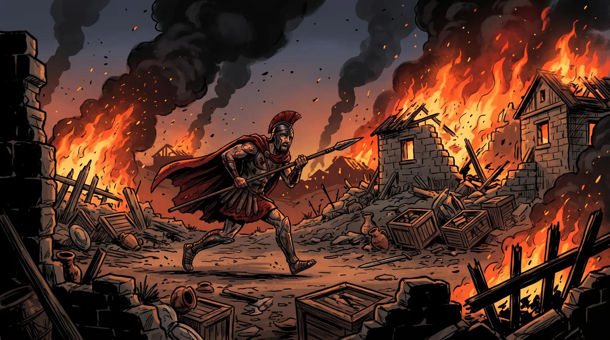
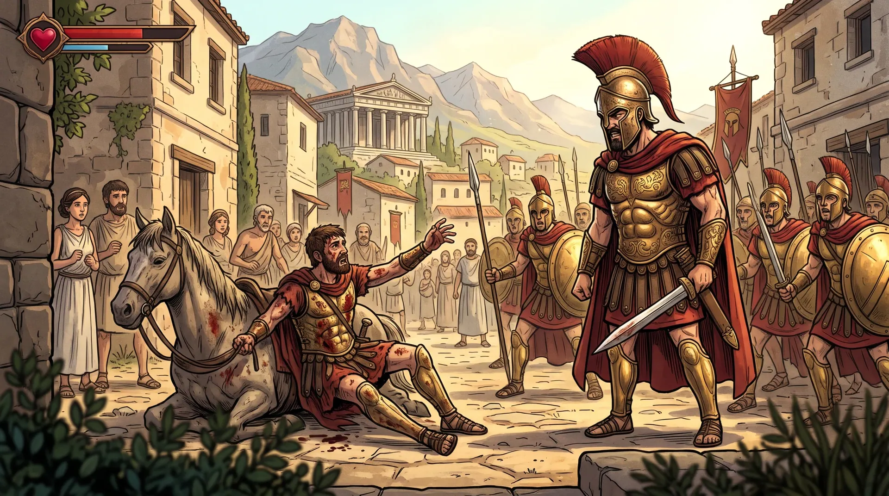
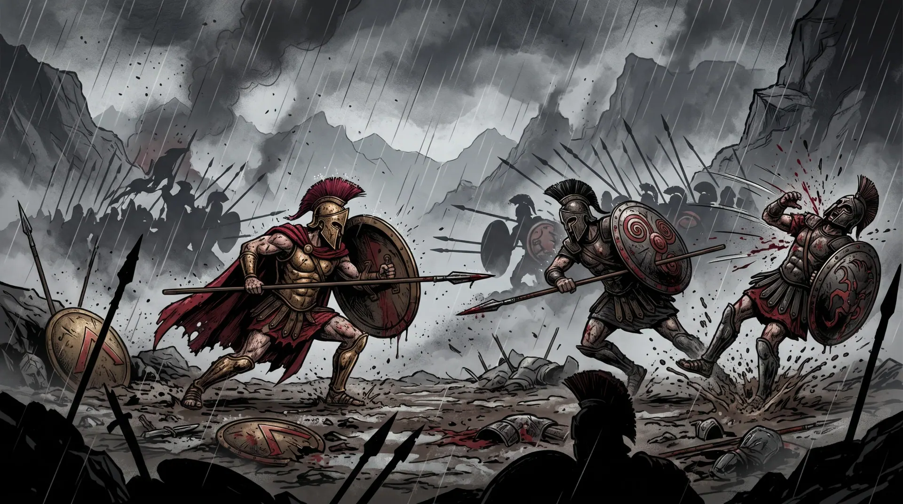
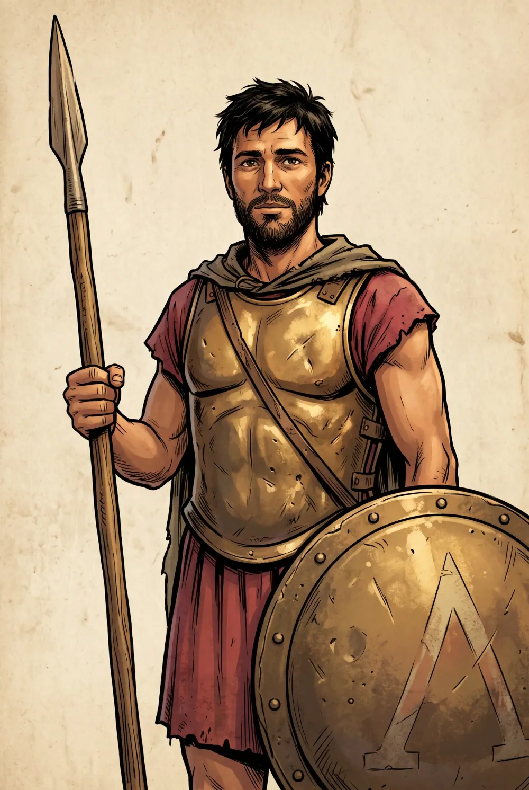
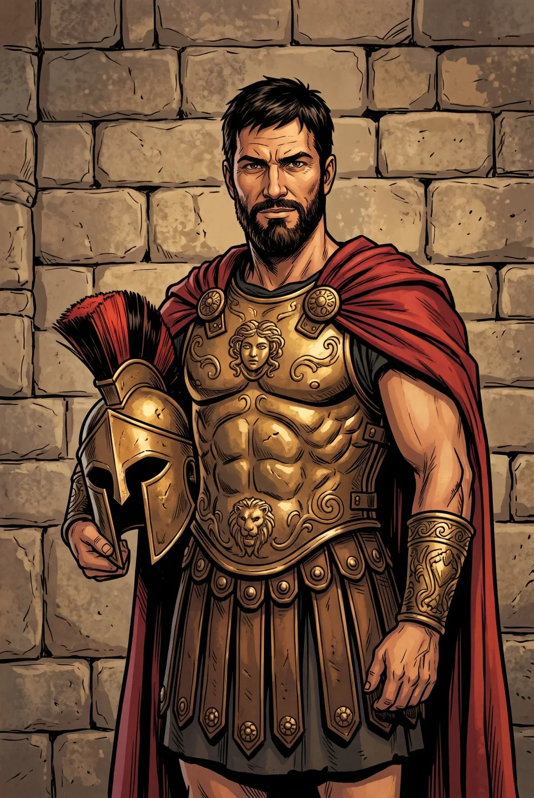
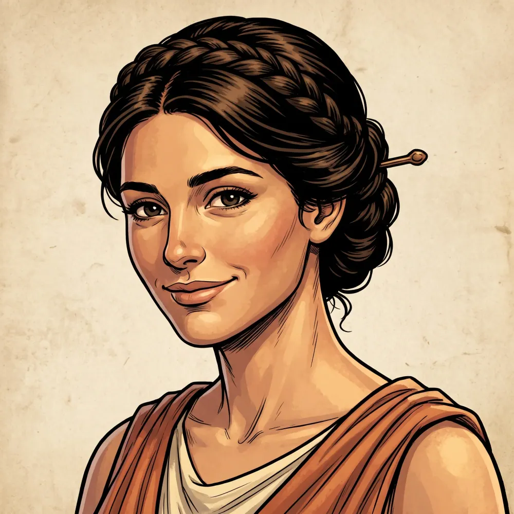
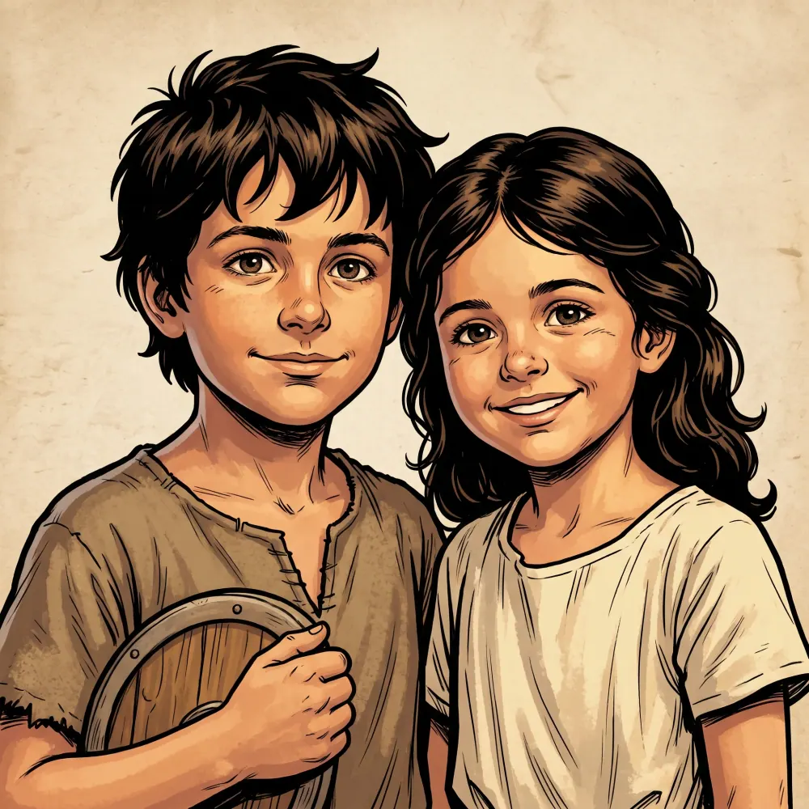

# The Last Spartan

> **BETA · PARTE 1: EL PRECIO DE LA GLORIA** — juego en desarrollo.



> _Buscó la gloria lejos de su hogar… y dejó la puerta abierta a la muerte._

Acción narrativa 2D/2.5D ambientada en la Época de los 300. No eres un semidiós:
eres un soldado espartano corriente que deja su puesto de guardia para buscar
gloria en el campo de batalla. Lanza, escudo y viñetas de cómic que aparecen
mientras juegas. Al volver, el hogar ya no está.

---

## Estado real del proyecto

| ✅ Ya existe | 🚧 En desarrollo |
| --- | --- |
| Parte 1 guionada: 3 escenas y 9 hitos narrativos | Prototipo jugable en Phaser |
| Arte conceptual y fotogramas de las escenas | Tráiler y demo publicables |
| Landing page estática de presentación (Astro 7) | Playtest y envío real del formulario |

Este repositorio contiene **la landing page** y el link del juego Beta.

---

## Link del juego
[🎮 Jugar The Last Spartan](https://2026b-sof-jueg-gr1.github.io/alpusig-erick-jueg-gr3/)

---

## La historia: tres actos

<table>
  <tr>
    <td width="33%"><b>1 · El llamado de la sangre</b><br><br><i>La paz se rompe cuando Argos marcha hacia el valle.</i></td>
    <td width="33%"><b>2 · El barro, la lanza y la caída</b><br><br><i>La falange se rompe y el General cae en el barro.</i></td>
    <td width="33%"><b>3 · Cenizas del deber</b><br><br><i>El mismo camino de vuelta, ahora convertido en ruinas.</i></td>
  </tr>
</table>

---

## Personajes

<table>
  <tr>
    <td width="25%" align="center"><br><b>El Soldado</b></td>
    <td width="25%" align="center"><br><b>El General</b></td>
    <td width="25%" align="center"><br><b>La Esposa</b></td>
    <td width="25%" align="center"><br><b>Los Niños</b></td>
  </tr>
</table>

---

## Pilares de diseño

- **Combate de lanza y escudo.** Estocadas, empujes y guardia direccional; en la
  Parte 1 el soldado no dispone de otras armas.
- **Narrativa en viñetas.** Globos de diálogo y recuadros de cómic sobre la
  acción, sin detener el juego.
- **Cinematografía híbrida.** Plano lateral 2D con secuencias 3D en los momentos
  de mayor impacto.
- **Escenarios que reflejan la consecuencia.** El sendero y la casa aparecen
  primero en paz y después en llamas.

---

## Ver la landing en local

Requiere Node.js **>= 22.23.4** (Astro 7).

```bash
npm install
npm run dev       # http://localhost:4321
npm run build     # genera dist/
npm run preview   # sirve dist/ para revisar el resultado
```

---

## Créditos

- **Arte conceptual y fotogramas: generados con Gemini (IA de Google).** Las
  imágenes publicadas son copias WebP optimizadas en `public/images/`; los
  originales se conservan fuera del repositorio.
- Código y diseño de la landing page: proyecto *The Last Spartan*.

---

## Para desarrolladores

**Estructura breve**

```
src/pages/index.astro       Composición de la página única
src/components/             Secciones, viñetas, modal y navegación
src/data/                   Textos, imágenes y enlaces editables
src/styles/                 Tokens de diseño + CSS por componente
src/scripts/                Sólo comportamiento de cliente
public/images/              WebP optimizado (scenes/ y characters/)
```

**Decisiones que importan**

- El contenido se genera en el build: el HTML final ya trae texto e imágenes,
  sin frameworks de UI y con buen SEO.
- El JavaScript sólo alterna estados (`hidden`, `aria-*`, clases); cada
  componente monta su propia feature con `mountSafely()` para aislar fallos.
- CSS global con tokens en `src/styles/tokens.css`; sin estilos *scoped* sobre
  atributos que cambia el JS.
- Accesibilidad: skip link, `h1` único, tablist ARIA en el roadmap, modal con
  trampa de foco, errores de formulario anunciados y soporte para
  `prefers-reduced-motion`.

| Qué editar | Dónde |
| --- | --- |
| Viñetas del cómic | `src/data/comic-panels.js` |
| Tres actos de la historia | `src/data/story-scenes.js` |
| Personajes y retratos | `src/data/characters.js` |
| Galería de fotogramas | `src/data/gallery-items.js` |
| Pilares, fases y enlaces | `src/data/` |
| Paleta, fuentes y espaciado | `src/styles/tokens.css` |
